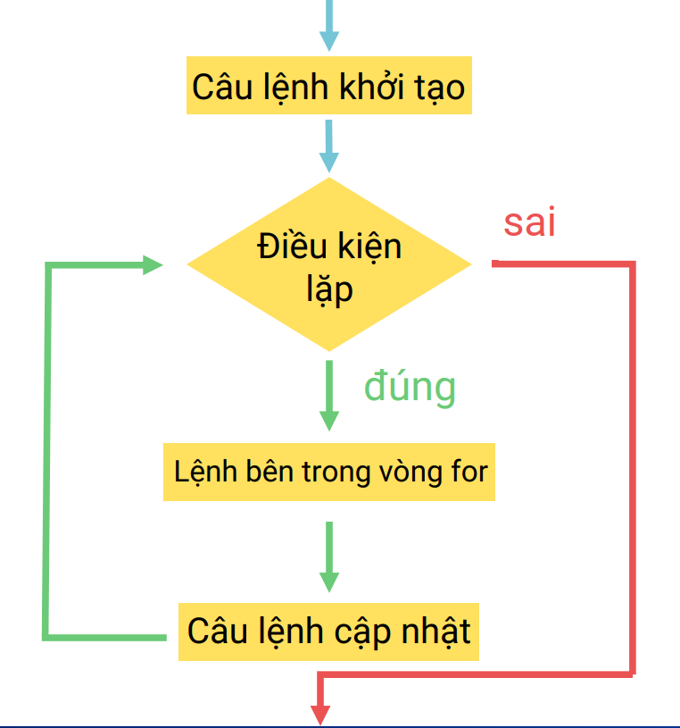
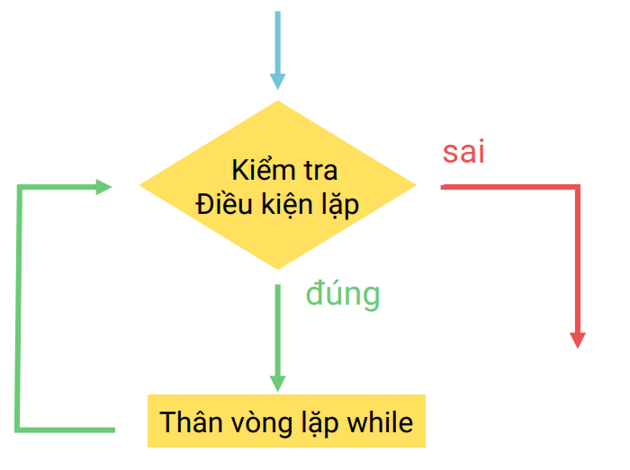
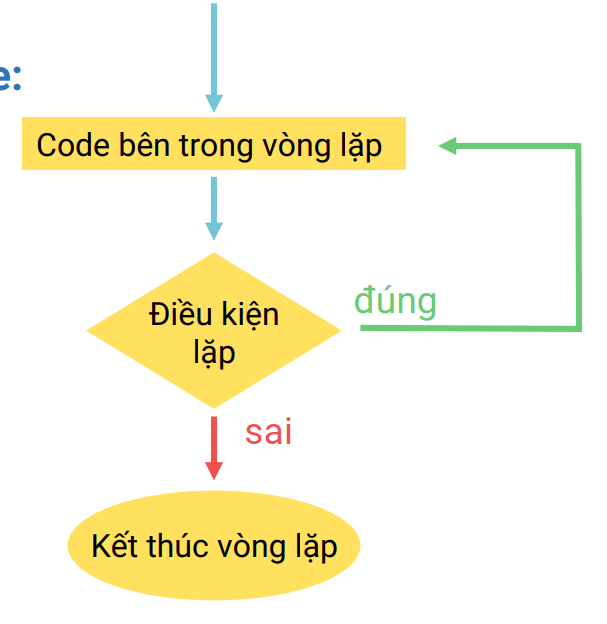

# VÒNG LẶP

## 📌 VẤN ĐỀ (PROBLEM)
Hãy viết chương trình in ra **1000** dòng `"Hello World!"`.  
Nếu không dùng vòng lặp, bạn sẽ phải viết 1000 lệnh `printf` / `System.out.println`.


---

## 1. VÒNG LẶP `FOR`

### Cú pháp
```java
for ([Câu lệnh khởi tạo]; [Điều kiện lặp]; [Câu lệnh cập nhật]) {
    // Câu lệnh bên trong vòng lặp for
}
```

Vòng lặp `for` gồm 3 phần chính, các phần phân cách nhau bằng dấu chấm phẩy `;`:
1. **Câu lệnh khởi tạo**: Thường là khai báo và khởi tạo một biến có nhiệm vụ làm biến đếm cho vòng `for` (`i`, `j`, `k`).
2. **Điều kiện lặp**: Chừng nào giá trị của điều kiện lặp còn có giá trị `true` thì vòng `for` còn lặp.
3. **Cập nhật biến đếm**: Thường phần này sẽ thay đổi giá trị của biến đếm sau khi các câu lệnh bên trong vòng lặp `for` được thực hiện xong.

### Cách sử dụng `for`
- Vòng lặp `for` được sử dụng nhiều nhất, và thường được sử dụng khi **biết trước số vòng lặp** cần thực hiện.
- Vòng `for` không nhất thiết phải có đủ cả 3 phần nhưng phải luôn có **đủ 2 dấu `;`** để phân cách giữa 3 phần.

### Sơ đồ khối


### Ví dụ
| Code | Output |
| :--- | :--- |
| `for (int i = 1; i <= 1000; i++) { System.out.println(i + " "); }` | `1 2 ... 1000` |
| `for (int i = 1; i <= 10; i += 2) { System.out.println(i + " "); }` | `1 3 5 7 9` |
| `for (int i = 1; ; i++) { System.out.println(i + " "); }` | Vòng lặp vĩnh viễn in ra các số tự nhiên bắt đầu từ 1 |
| `for (; i <= 10; i++) { System.out.println(i + " "); }` | **Compilation error** (chưa khai báo biến `i`) |
| `for (int i = 1; i <= 10; ) { System.out.println(i + " "); }` | Vòng lặp in ra vô hạn các số `1` |
| `int i = 1; for (; i <= 100; i++) { } System.out.println(i + " ");` | `101` |

---

### Break và Continue
Khi muốn dừng vòng lặp `for` với một điều kiện cho trước, ta dùng câu lệnh `break`.  
Khi gặp câu lệnh `break`, vòng `for` sẽ **kết thúc ngay lập tức**. Thông thường `break` sẽ đi kèm với câu lệnh `if` để kiểm tra điều kiện dừng.

```java
for ([Câu lệnh khởi tạo]; [Điều kiện lặp]; [Câu lệnh cập nhật]) {
    // Các câu lệnh trước break
    if (condition) {
        break; // Câu lệnh sẽ được thực thi khi condition = true
    }
    // Nhóm câu lệnh sau break
}
```
```java
// vòng lặp
//    for(giá trị khởi tạo, điều kiện lặp, câu lệnh cập nhật){
//        // câu lệnh bên trong vòng lặp for
//    }
//    ví dụ 
//    for(int i = 1;i<=5;i++){
//        System.out.println(i);
//    }
//    đầu tiên vòng for sẽ chạy vào và khởi tạo biến i = 1; sau khi khởi tạo xong sẽ nhảy sang bên phải check điều kiện lặp xem i có nhỏ hơn bằng 5 không nếu đúng thì thực hiện vòng lặp nếu sai thì kết thúc vòng for ngay lập tức , sau khi in ra dòng i thì sẽ quay lại i++ để tăng biến i lên 1 đơn vị; tăng xong sẽ chuyển sang check đk nếu đúng thì in ra i tiếp hoặc nếu sai thì thoát vòng lặp
//    vòng for có thể bị khuyết 1 phần
//    for(int i = 1;;i++){
//        // vòng for này sẽ lặp vô tận
//    }
//    for(int i = 1;i<=5;){
//        // vòng for này sẽ lặp vô tận
//    }
//biến i khai báo trong vòng for sẽ thuộc về trong vòng for và ở ngoài không sử dụng được
//    for(int i = 1;i<=5;i++){
//        System.out.println(i);
//    }
//    System.out.println(i);
//nếu muốn sử dụng biến i thì phải khai báo i ở ngoài vòng for rồi vào trong mới sử dụng

//    ví dụ chương trình tính tổng từ 1 đến n
//    long tong = 0;
//    for(int i = 1; i<= 10;i++){
//        tong+=i;
//    }
//    System.out.println(tong);
//    câu lệnh break dùng để kết thúc vòng lặp ngay lập tức khi 1 điều kiện nào đó xẩy ra
//    for(int i = 1; i<= 10;i++){
//        System.out.println(i);
//        if(i == 3){
//            break;
//        }
//        System.out.println("Hello");
//    }
//      câu lệnh continue xẩy ra thì câu lệnh sẽ quay trở lại vòng lặp mới luôn và bỏ qua phần câu lệnh bên dưới
    for(int i = 1; i<= 10;i++){
        
        if(i == 3){
            continue;
        }
        System.out.println(i);
    }    
```
---

## 2. VÒNG LẶP `WHILE`

### Cú pháp
```java
while ([Điều kiện lặp]) {
    // Các câu lệnh của vòng lặp
}
```

### Cách sử dụng `while`
- Khi điều kiện lặp còn đúng (`true`) thì vòng `while` còn tiếp tục hoạt động và các câu lệnh bên trong vòng `while` sẽ tiếp tục được thực hiện.
- Vòng lặp `while` được sử dụng khi **chưa xác định được số vòng lặp** cần thực hiện.
- **Lỗi thường gặp:** Lặp vĩnh viễn (quên cập nhật điều kiện lặp).



### Ví dụ
| Code | Output |
| :--- | :--- |
| `int i = 1; while (i <= 5) { System.out.println(i + " "); ++i; }` | `1 2 3 4 5` |
| `while (true) { System.out.println("28tech"); }` | In ra vô hạn dòng `28tech` |
| `int i = 1; while (i <= 5) { System.out.println(i + " "); }` | In ra vô hạn số `1` |
| `int i = 1; while (i <= 5) { i += 2; } System.out.println(i + " ");` | `7` |
| `int n = 1234; while (n != 0) { System.out.println(n % 10); n /= 10; }` | `4`<br>`3`<br>`2`<br>`1` |
| `int n = 1234; int sum = 0; while (n != 0) { sum += n % 10; n /= 10; } System.out.println(sum);` | `10` |

```java
//          int n = 3;
//        vòng lặp while

//        while(điều kiện lặp){ // bao h điều kiện lặp của vòng lặp đúng thì nó vẫn chạy, còn khi nó sai thì nó sẽ dừng
//            các điều kiện của vòng lặp
//ví dụ bài in ra các số từ 3 về 0
//          while(n >= 0){
//              System.out.println(n);
//              n--;
//          }
          
//          int j = 1, k = 3;
//          while(j <= k){
//              System.out.println(j);
//              j++;
//          }
            
// bài này sẽ dính vào vòng lặp vĩnh viễn 1 vì chạy lệnh in ra màn hình làn đầu nó vào if và gặp continue và nó sẽ bỏ qua i++ nên giờ i ko được cập nhật lên 2 nên nó sẽ bị lặp vĩnh viễn ở 1

//            int i = 1, n = 3;
//            while(i <= n){
//                System.out.println(i);
//                if(n % 2 == 1){
//                    continue;
//                }
//                i++;
//            }

             // vòng lặp while thường áp dụng cho đếm chữ số, tính tổng chữ số, đếm chữ số chẵn, chữ số lẻ,...
//             int dem = 0;
//             int so = 12345;
//             while(so!=0){
//                 dem++;
//                 so/=10;
//             }
//             System.out.println(dem);
//             
//             // nếu đổi vị trí thì nó vẫn đúng
//             while(so!=0){
//                 so/=10;
//                 dem++;
//             }
//             System.out.println(dem);
```

---

## 3. VÒNG LẶP `DO WHILE`

### Cú pháp
```java
do {
    // Code bên trong vòng lặp
} while ([Điều kiện lặp]);
```

### Cách sử dụng `do while`
- **Hoạt động:** Tương tự như vòng `while`, nhưng `do while` luôn **thực thi code bên trong vòng lặp 1 lần đầu tiên**, sau đó mới kiểm tra điều kiện lặp.
- Sử dụng khi **chưa xác định được số vòng lặp** cần thực hiện nhưng muốn chạy khối lệnh ít nhất 1 lần.
- **Lỗi thường gặp:** Thiếu dấu `;` đằng sau `while(...)`.

### Sơ đồ khối




### Ví dụ
| Code | Output |
| :--- | :--- |
| `int i = 100; do { System.out.println(i); } while (i < 100);` | `100` |
| `int i = 1; do { System.out.println(i); i++; } while (i <= 5);` | `1 2 3 4 5` |

```java
//            vòng lặp do while
//              cú pháp 
//            do{
//            code trong vòng lặp
//            }while([điều kiện lặp]); lưu ý cuối while có dấu ;
//do while sẽ chạy code trước sau đó mới chạy điều kiện nếu điều kiện đúng thì chạy tiếp còn không thì chạy câu lệnh bên dưới chương trình
//             int n = 1;
//             do{
//                 System.out.println("do__");
//                 n++;
//             }while(n<= 4);
            
//            for lồng nhau vòng for ở ngoài chạy được 1 lần thì vòng for trong phải chạy hết mới tiếp lần thứ 2 và cũng phải chạy hết vòng for ở trong mới tiếp tục vòng thứ 3
//            for(int i = 1;i <= 3;i++){
//                for(int j = 1; j <= 2;j++){
//                    System.out.println(i+ " " + j);
//                }
//            }
//            cú pháp outer: nghĩa là khi thêm nó ở vòng for ngoài mà break ở vòng for trong thì thường thì nó sẽ thoát vòng trong còn nếu dùng outer như ở dưới thì nó sẽ thoát vòng luôn khi gặp
//            outer: for(int i = 1;i <= 3;i++){outer thì đặt 1 tên bất kì nào đó và trong c++ không có cái này
//                for(int j = 1; j <= 2;j++){
//                    System.out.println(i+ " " + j);
//                    if(i == 3) break outer; 
//                }
//            }
//            câu lệnh kết thúc chương trình khi gặp nó
//              if(true)return;// câu lệnh dưới sẽ không bao h chạy được vì nó gặp return
//              System.out.println("__");
```